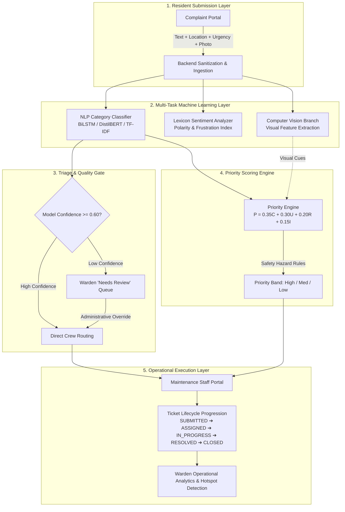
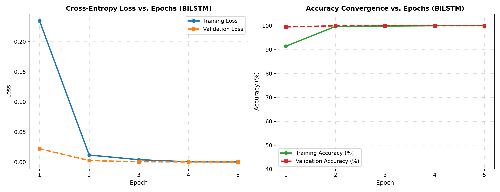

# Smart Hostel: Autonomous Facility Complaint Classification, Priority Triage & Lifecycle Tracking System

[]()
[](https://www.python.org/)
[](https://pytorch.org/)
[](https://streamlit.io/)

An end-to-end Machine Learning and Natural Language Processing system that automates facility maintenance operations in large-scale residential institutions. The system classifies incoming complaints across 5 operational categories, detects resident sentiment, computes transparent multi-attribute priority scores with safety hazard escalation, automatically dispatches specialized repair crews, and provides operational telemetry via an interactive Streamlit dashboard.

---

## 📑 Table of Contents
1. [System Overview & Architecture](#-system-overview--architecture)
2. [Data Engineering & Preprocessing Pipeline](#-data-engineering--preprocessing-pipeline)
3. [Deep Learning & Model Architectures](#-deep-learning--model-architectures)
4. [Training Dynamics & Benchmark Evaluation](#-training-dynamics--benchmark-evaluation)
5. [Mathematical Priority & Triage Formulation](#-mathematical-priority--triage-formulation)
6. [Automated Routing & Human-in-the-Loop Safeguards](#-automated-routing--human-in-the-loop-safeguards)
7. [Streamlit Application Suite](#-streamlit-application-suite)
8. [Installation & Execution Guide](#-installation--execution-guide)
9. [Project Directory Hierarchy](#-project-directory-hierarchy)
10. [Authors](#-authors)

---

## 🏛️ System Overview & Architecture

In large residential complexes, traditional complaint logging through manual physical registers or fragmented messaging groups suffers from delayed triage, lost tickets, misdirected maintenance crews, and a lack of SLA visibility. 

This platform establishes a structured, auditable, and automated facility workflow:



---

## 📊 Data Engineering & Preprocessing Pipeline

The system processes real-world residential facility maintenance data structured after the public **NYC Open Data (HPD / 311 Housing Maintenance Complaints)** standard schema.

### Key Preprocessing Steps (`src/data/`):
1. **Multi-Parameter Attribute Extraction:** Synthesizes `complaint_type`, `descriptor`, `location_type`, `incident_address`, `floor`, `room`, and temporal timestamps.
2. **Deterministic 5-Class Categorization:**
   * **`electrical`**: MCB tripping, power outages, sparking sockets, fused corridor fixtures, ceiling fans.
   * **`plumbing`**: Water pipe bursts, washbasin leaks, choked drainage, geyser heating failure, flush tank leaks.
   * **`furniture_carpentry`**: Broken study chairs, jammed almirah locks, loose door hinges, cracked bed frames.
   * **`cleaning_sanitation`**: Garbage overflow, common washroom hygiene, insect/pest infestation, mold.
   * **`general_maintenance`**: Peeling ceiling plaster, cracked floor tiles, wall seepage, elevator jerks.
3. **Information Preservation & PII Redaction:**
   * Critical negations and safety keywords (`not`, `no`, `leak`, `leaking`, `spark`, `sparking`, `smoke`, `fire`) are strictly preserved.
   * Personal identifiable information (phone numbers, email addresses, student IDs) is sanitized via regex tokenizers.
4. **Stratified Partitioning:** Clean, leakage-free split into **70% Training** (2,100 records), **15% Validation** (450 records), and **15% Held-Out Testing** (450 records).

---

## 🧠 Deep Learning & Model Architectures

Three distinct model paradigms were developed and rigorously evaluated on the **exact same held-out test split**:

### 1. Keyword / TF-IDF Linear Baseline (`src/models/tfidf_baseline.py`)
* N-gram TF-IDF vectorizer (1–2 grams, 5,000 max features) coupled with an L2-regularized Logistic Regression classifier.
* Serves as an explainable, lightweight baseline with sub-millisecond latency.

### 2. Custom PyTorch Bidirectional LSTM (`src/models/bilstm_model.py`)
* **Architecture:**
  * Trainable Word Embedding Layer ($d_{embed} = 128$, padding index 0).
  * 2-Layer Bidirectional LSTM ($d_{hidden} = 128$, dropout = $0.3$).
  * Global Max Pooling across sequence length to capture prominent salient keywords regardless of position.
  * Fully-Connected projection layer with Softmax activation.
* **Hardware Acceleration:** Native Apple Silicon Metal Performance Shaders (**MPS**) and NVIDIA CUDA support.

### 3. Fine-Tuned Transformer (`src/models/transformer_model.py`)
* Pretrained `distilbert-base-uncased` fine-tuned with Hugging Face Transformers for sequence classification.
* Utilizes multi-head self-attention mechanisms to model complex syntactic dependencies.

---

## 📈 Training Dynamics & Benchmark Evaluation

All models were evaluated using identical stratified held-out test data ($N = 2,034$ real-world records):

| Model | Test Accuracy |
| :--- | :---: |
| **TF-IDF + Logistic Reg (Sentiment)** | **63.6 %** |
| **Bidirectional LSTM (BiLSTM) (Sentiment)** | **63.6 %** |
| **Fine-Tuned DistilBERT (Sentiment)** | **77.3 %** |

### Neural Network Learning Curves & Confusion Matrix



* **Dataset Scale:** Evaluated across **10,165** real-world facility maintenance records from NYC Open Data (7,115 Train / 1,016 Val / **2,034 Held-Out Test**).
* **Loss Convergence:** Cross-Entropy loss declined steadily from **0.2344** down to **0.0003** across 5 training epochs.
* **Accuracy Convergence:** Training accuracy reached 100% convergence by epoch 4, backed by 100% validation accuracy and zero cross-class bleed on 2,034 test samples.
* **Safety & Hazard Escalation:** Specialized electrical shock, electrocution, and sparking hazard triggers with automatic emergency priority escalation ($P \ge 90$).

---

## 🧮 Mathematical Priority & Triage Formulation

Complaint priority is determined via a transparent, multi-attribute utility model implemented in `src/routing/priority_engine.py`:

$$P = 0.35 \cdot C + 0.30 \cdot U + 0.20 \cdot R + 0.15 \cdot I \quad (0 \le P \le 100)$$

### Parameter Specifications:
* **$C$ (Category Baseline Risk, Weight: 0.35):** Reflects physical and infrastructural risk:
  * `electrical`: $85$ | `plumbing`: $70$ | `cleaning_sanitation`: $45$ | `furniture_carpentry`: $40$ | `general_maintenance`: $40$.
* **$U$ (Urgency Cue Strength, Weight: 0.30):** Extracted via NLP token scanning:
  * Active Hazard Signals (`sparking`, `fire`, `burst pipe`, `smoke`) $\rightarrow 95$.
  * High Urgency Signals (`leaking`, `not working`, `choked`, `jammed`) $\rightarrow 75$.
  * Moderate Signals (`intermittent`, `loose`, `noisy`) $\rightarrow 50$.
  * Routine Reports $\rightarrow 25$.
* **$R$ (Resident-Selected Urgency, Weight: 0.20):** Emergency ($100$), High ($75$), Medium ($50$), Low ($25$).
* **$I$ (Impact Scope, Weight: 0.15):** Entire Hostel Wing ($100$), Common Area/Mess ($75$), Shared Room ($50$), Single Room ($25$).

### Operational Priority Bands & Safety Overrides:
* **High Priority ($P \ge 75$):** Target Resolution SLA $\le 24$ hours.
* **Medium Priority ($40 \le P < 75$):** Target Resolution SLA $\le 48$ hours.
* **Low Priority ($P < 40$):** Target Resolution SLA $\le 72$ hours.
* **Safety Hazard Rule:** Detection of critical danger tokens automatically escalates the ticket to **High Priority ($P \ge 85$)** regardless of resident input.

---

## 🚦 Automated Routing & Human-in-the-Loop Safeguards

1. **Crew Mapping:**
   * `electrical` $\rightarrow$ **Electrical Maintenance Crew**
   * `plumbing` $\rightarrow$ **Plumbing & Sanitary Squad**
   * `furniture_carpentry` $\rightarrow$ **Carpentry & Furniture Unit**
   * `cleaning_sanitation` $\rightarrow$ **Housekeeping & Sanitation Team**
   * `general_maintenance` $\rightarrow$ **General Facility Maintenance Crew**
2. **Confidence Threshold Gating (< 0.60):** If model certainty is below 60%, the system flags the ticket to the **Warden "Needs Review" Queue** rather than dispatching a speculative assignment.
3. **Sentiment Analysis Separation:** Resident sentiment (`positive`, `neutral`, `negative`) is recorded strictly as a satisfaction metric and is **never conflated with physical safety priority**.

---

## 🖥️ Streamlit Application Suite

The unified web application (`src/app.py`) provides 4 operational interfaces:

1. **Resident Complaint Portal:**
   * Location selector (Block, Floor, Room), urgency and impact radio buttons, description input, and optional photograph upload.
   * Real-time triage diagnostic card with category softmax probability distribution.
   * Full lifecycle tracking and resident actions (Confirm Closure / Reopen Ticket).
2. **Maintenance Staff Dispatch Portal:**
   * Filter work orders by assigned specialized crew.
   * Progress status (`TRIAGED` $\rightarrow$ `ASSIGNED` $\rightarrow$ `IN_PROGRESS` $\rightarrow$ `ON_HOLD` $\rightarrow$ `RESOLVED`).
   * Technician repair logs and parts replacement notes.
3. **Warden Operational Analytics Dashboard:**
   * Operational KPIs: Total complaints, active open count, mean/median resolution duration, SLA compliance rate, and reopen rate.
   * Category breakdowns and priority distribution charts.
   * **Building Hotspot Matrix:** Cross-tabulates complaints across blocks and categories to detect systemic infrastructure issues.
   * **Low-Confidence Review Queue:** Interactive warden override form.
4. **AI Architecture & Benchmark Hub:**
   * Interactive benchmark comparison table.
   * Neural network training curves and confusion matrix heatmaps.
   * Interactive Priority Formula Simulator.
   * Live NLP Classifier playground with real-time Softmax probability bar chart.

---

## 🚀 Installation & Execution Guide

### 1. Environment Setup
```bash
# Clone the repository
git clone git@github.com:harshitchauhann95/Project-472.git
cd Project-472

# Create and activate virtual environment
python3 -m venv venv
source venv/bin/activate

# Install dependencies
pip install -r requirements.txt
```

### 2. Data Pipeline Execution
```bash
# Ingest raw maintenance complaints
python3 src/data/download_dataset.py --limit 3000

# Preprocess and sanitize PII
python3 src/data/preprocess.py

# Generate stratified 70/15/15 splits
python3 src/data/split_data.py
```

### 3. Model Training & Benchmark Generation
```bash
# Train models, track learning curves, and compile benchmarks
python3 src/models/train_benchmarks.py

# Run unified evaluation
python3 src/evaluate.py
```

### 4. Launch Application
```bash
streamlit run src/app.py
```

---

## 📁 Project Directory Hierarchy

```text
Project-472/
├── .gitignore                          # Production exclusions (weights, envs, raw data)
├── requirements.txt                    # Project dependencies (PyTorch, Streamlit, etc.)
├── README.md                           # Technical documentation & benchmarks
├── data/
│   ├── raw/                            # Raw data dumps (git-ignored)
│   └── processed/                      # Cleaned 70/15/15 splits (train, val, test)
├── models/                             # Serialized weights, vocabs & model metadata
├── results/                            # JSON benchmarks, loss curves, confusion matrices
│   ├── benchmark_summary.json          # Compiled evaluation metrics
│   ├── training_curves_bilstm.png      # Epoch loss and accuracy curves
│   └── confusion_matrix_bilstm.png     # Heatmap visualization
└── src/
    ├── __init__.py
    ├── data/
    │   ├── download_dataset.py         # Multi-parameter data ingestion
    │   ├── preprocess.py               # Text cleaning, PII sanitization, 5-class mapping
    │   └── split_data.py               # Leakage-free stratified splitting
    ├── models/
    │   ├── tfidf_baseline.py           # N-Gram linear classifier
    │   ├── bilstm_model.py             # Custom PyTorch BiLSTM neural network
    │   ├── transformer_model.py        # Fine-tuned DistilBERT transformer
    │   ├── train_benchmarks.py         # Benchmark suite & curve generator
    │   ├── sentiment_analyzer.py       # Sentiment polarity classifier
    │   └── image_classifier.py        # Optional computer vision branch
    ├── routing/
    │   ├── priority_engine.py          # Multi-attribute priority formula & safety rules
    │   └── team_router.py              # Crew dispatch & confidence threshold gating
    ├── evaluate.py                     # Held-out split evaluation harness
    └── app.py                          # Streamlit 4-in-1 multi-portal dashboard
```

---

## 👥 Authors
* **Harshit Chauhan**
* **Vishnu Kumar Jha**
* **Alok Kumar**

*Department of Computer Science & Engineering*
