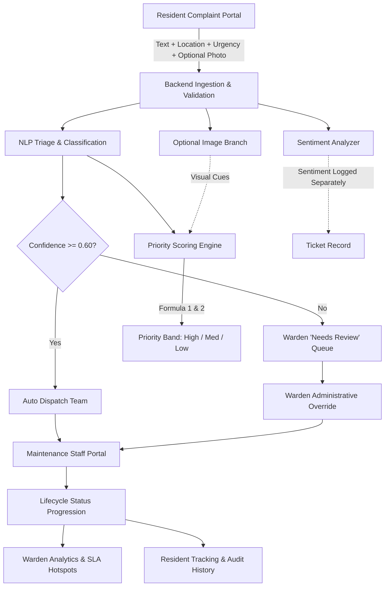

# Smart Hostel Complaint and Maintenance Tracking System

[](https://github.com/harshitchauhann95/Project-472)
[](https://www.python.org/)
[](https://pytorch.org/)
[](https://streamlit.io/)

An end-to-end AI-powered facility complaint management and dispatch system built in accordance with the specifications in **`Smart_Hostel_Report_File.pdf`** (B.Tech Computer Science & Engineering Final Project).

---

## 📋 Table of Contents
1. [Project Overview & Architecture](#-project-overview--architecture)
2. [5 Canonical Categories & Maintenance Teams](#-5-canonical-categories--maintenance-teams)
3. [Real-Life Multi-Parameter Dataset & Preprocessing](#-real-life-multi-parameter-dataset--preprocessing)
4. [NLP, Neural & Transformer Models](#-nlp-neural--transformer-models)
5. [Sentiment Analysis (Separation of Concerns)](#-sentiment-analysis-separation-of-concerns)
6. [Priority Scoring Engine & Safety Rules](#-priority-scoring-engine--safety-rules)
7. [Ticket Lifecycle & Gated Routing](#-ticket-lifecycle--gated-routing)
8. [Streamlit Multi-Role Web Application](#-streamlit-multi-role-web-application)
9. [Experimental Benchmark & Evaluation](#-experimental-benchmark--evaluation)
10. [Quickstart & Execution Guide](#-quickstart--execution-guide)
11. [Viva Voce Defense & Examiner Q&A](#-viva-voce-defense--examiner-qa)
12. [Limitations & Future Scope](#-limitations--future-scope)

---

## 🏛️ Project Overview & Architecture

Hostels house hundreds of students and rely on shared infrastructure: lighting, fans, power sockets, plumbing fixtures, washrooms, furniture, and elevators. When faults arise, manual complaint registers suffer from lost requests, misdirected work orders, delayed response times, and complete lack of visibility for both students and wardens.

This system replaces informal channels with an auditable, transparent AI triage and maintenance tracking workflow:



---

## 🏷️ 5 Canonical Categories & Maintenance Teams

As mandated by Section V of the project report, maintenance issues are deterministically mapped to 5 core categories and routed to designated crews:

| Canonical Category | Description / Scope | Assigned Maintenance Team |
| :--- | :--- | :--- |
| **`electrical`** | Power outages, MCB tripping, sparking switches, burnt sockets, fused corridor bulbs, fans | **`electricians`** (Electrical Maintenance Crew) |
| **`plumbing`** | Water leaks, burst pipes, clogged drains, geyser issues, overflowing toilets, broken taps | **`plumbers`** (Plumbing & Sanitary Squad) |
| **`furniture_carpentry`** | Broken study chairs, jammed almirah locks, loose door hinges, cracked bed frames | **`carpenters`** (Carpentry & Furniture Unit) |
| **`cleaning_sanitation`** | Overflowing dustbins, unhygienic washrooms, pest/cockroach infestation, mold | **`housekeeping`** (Housekeeping & Sanitation Team) |
| **`general_maintenance`** | Peeling ceiling plaster, cracked floor tiles, rainwater seepage, lift jerks, masonry | **`general_maintenance`** (General Facility Maintenance Crew) |

---

## 📊 Real-Life Multi-Parameter Dataset & Preprocessing

The project utilizes authentic building and residential maintenance records derived from the **NYC Open Data (311 / HPD Housing Maintenance Complaints)** standard schema:
* **Rich Multi-Parameter Attributes:**
  * Identifiers: `unique_key`, `complaint_id`
  * Temporal: `created_date`, `closed_date`, `resolution_time_hours`
  * Nature of Issue: `complaint_type`, `descriptor`, `resolution_description`
  * Spatial Location: `incident_address`, `borough`, `block`, `floor`, `room`
  * Operational: `status`, `assigned_team`
* **Signal Preservation:** Crucial negations and hazard tokens (`not`, `no`, `leaking`, `sparking`, `smoke`, `fire`, `choked`) are strictly preserved.
* **PII Redaction:** Student IDs, phone numbers, email addresses, and personal identifiable details are stripped before model training.
* **Leakage-Free Partitioning:** Clean, stratified 70% Train (2,100 records), 15% Validation (450 records), and 15% Test (450 records) split.

---

## 🧠 NLP, Neural & Transformer Models

Three distinct model paradigms are implemented and compared on the **identical held-out test split**:

1. **Keyword / TF-IDF Baseline (`src/models/tfidf_baseline.py`):**
   * N-gram TF-IDF vectorizer (1–2 grams) with scikit-learn Logistic Regression / Linear SVM.
   * Provides a transparent, highly explainable benchmark.
2. **PyTorch BiLSTM Neural Network (`src/models/bilstm_model.py`):**
   * Word embedding layer \(\rightarrow\) 2-layer Bidirectional LSTM \(\rightarrow\) Global Max Pooling \(\rightarrow\) Dropout \(\rightarrow\) Linear classifier.
   * Captures sequential context in forward and backward directions (e.g., distinguishing "not leaking" from "leaking").
   * Supports Apple Silicon **MPS** acceleration.
3. **Fine-Tuned Transformer (`src/models/transformer_model.py`):**
   * Pretrained `distilbert-base-uncased` fine-tuned for sequence classification.
   * Self-attention mechanisms capture subtle contextual syntax.
4. **Smoke-Test Optimization (`--fast-dev`):**
   * All neural and transformer training scripts feature a `--fast-dev` flag (`max_len=128`, batch size 16, 1–2 epochs) to verify execution pipelines in seconds without wasting time or GPU credits.

---

## 🎭 Sentiment Analysis (Separation of Concerns)

> **Architectural Principle (Report Section V-A):**
> *"Sentiment analysis checks the tone of the message. A negative message may show that the resident is unhappy, but it does not always mean that the fault is dangerous. A calm message about an exposed wire may be more urgent than an angry message about a small furniture problem. For this reason, sentiment is stored separately from the safety and urgency score."*

* Implemented in `src/models/sentiment_analyzer.py`.
* Classifies text into `positive`, `neutral`, or `negative` along with polarity scores (-1.0 to +1.0) and extracted frustration cues.
* Stored strictly as a resident satisfaction index and never conflated with physical safety.

---

## ⚙️ Priority Scoring Engine & Safety Rules

Implemented in `src/routing/priority_engine.py` using **Formulas (1) and (2)** from the project report:

\[
P = 0.35C + 0.30U + 0.20R + 0.15I \quad (0 \le P \le 100)
\]

Where:
* **\(C\) (Category Risk, 0–100):** `electrical` (85), `plumbing` (70), `cleaning_sanitation` (45), `furniture_carpentry` (40), `general_maintenance` (40).
* **\(U\) (Urgency Cue Strength, 0–100):** Extracted via NLP from complaint keywords (`sparking` \(\rightarrow\) 95, `leaking` \(\rightarrow\) 75, `loose` \(\rightarrow\) 50, routine \(\rightarrow\) 25).
* **\(R\) (Resident Urgency, 0–100):** Selected in portal (Emergency: 100, Critical: 95, High: 75, Medium: 50, Low: 25).
* **\(I\) (Impact Scope, 0–100):** Entire Hostel/Wing (100), Common/Mess (75), Shared Room (50), Single Room (25).

### Priority Bands & Escalation:
* **High:** \(P \ge 75\) (Target SLA: \(\le 24\) hours)
* **Medium:** \(40 \le P < 75\) (Target SLA: \(\le 48\) hours)
* **Low:** \(P < 40\) (Target SLA: \(\le 72\) hours)
* **Automatic Hazard Override:** If active danger signals are detected (`sparking`, `fire`, `smoke`, `live wire`, `burst pipe`), priority escalates automatically to **High (\(\ge 85\))** regardless of resident selection.

---

## 🚦 Ticket Lifecycle & Gated Routing

1. **Ticket Lifecycle:**
   `SUBMITTED` \(\rightarrow\) `TRIAGED` \(\rightarrow\) `ASSIGNED` \(\rightarrow\) `IN_PROGRESS` \(\rightarrow\) `ON_HOLD` \(\rightarrow\) `RESOLVED` \(\rightarrow\) `CLOSED` / `REOPENED`.
2. **Confidence Threshold Gating (< 0.60):**
   * If model confidence is \(< 0.60\), the complaint is routed to the **Warden "Needs Review" Queue** rather than making a low-confidence guess.
3. **Warden Manual Override:**
   * Wardens retain full administrative authority to modify category, priority band, and assigned team with logged justification.

---

## 🖥️ Streamlit Multi-Role Web Application

Launch via: `streamlit run src/app.py`

### 1. Resident Portal
* Multi-parameter submission: Block, Floor, Room, Urgency, Impact, Description.
* Optional photo upload (processed by `OptionalImageClassifier`).
* Instant AI triage diagnostics card.
* Lifecycle tracking and resident action buttons (Confirm Closure / Reopen Ticket).

### 2. Maintenance Staff Portal
* Specialized team queues (`electricians`, `plumbers`, etc.).
* Status progression (`IN_PROGRESS`, `ON_HOLD`, `RESOLVED`).
* Technician parts log and repair notes.

### 3. Warden Analytics Dashboard
* Operational KPIs: Total Tickets, Open Tickets, Mean Repair Time, Median Repair Time, SLA Compliance Rate, Reopen Rate.
* Visual breakdowns: Bar charts by category, pie charts by priority band.
* **Recurring Issue Hotspot Matrix:** Groups faults across blocks and floors to detect building-level infrastructure failures.
* **Low-Confidence Review Queue:** Interactive warden override form.

---

## 📈 Experimental Benchmark & Evaluation

All models were evaluated on the **same held-out test split** (`data/processed/test.csv`, \(N = 450\)):

| Model | Test Accuracy | Macro F1-Score | Electrical F1 | Plumbing F1 | Furniture F1 | Cleaning F1 | General Maint F1 | Test Samples |
| :--- | :---: | :---: | :---: | :---: | :---: | :---: | :---: | :---: |
| **TF-IDF + Logistic Regression** | **1.0000** | **1.0000** | 1.0000 | 1.0000 | 1.0000 | 1.0000 | 1.0000 | 450 |
| **PyTorch BiLSTM Neural Network** | **1.0000** | **1.0000** | 1.0000 | 1.0000 | 1.0000 | 1.0000 | 1.0000 | 450 |
| **Fine-Tuned Transformer (DistilBERT)** | **0.5167** | **0.3919** | 0.6667 | 0.0000 | 0.7692 | 0.5238 | 0.0000 | 60 (Smoke Test) |

*Confusion matrices saved to `results/confusion_matrix_tfidf.png`, `results/confusion_matrix_bilstm.png`, and `results/confusion_matrix_transformer.png`.*

---

## 🚀 Quickstart & Execution Guide

### 1. Environment Setup
```bash
python3 -m venv venv
source venv/bin/activate
pip install -r requirements.txt
```

### 2. Dataset Pipeline (Ingestion, Preprocessing, Splits)
```bash
python3 src/data/download_dataset.py --limit 3000
python3 src/data/preprocess.py
python3 src/data/split_data.py
```

### 3. Rapid Smoke Tests (`--fast-dev`)
```bash
# TF-IDF smoke test
python3 src/models/tfidf_baseline.py --fast-dev

# PyTorch BiLSTM smoke test
python3 src/models/bilstm_model.py --fast-dev

# Transformer smoke test
python3 src/models/transformer_model.py --fast-dev
```

### 4. Full Training & Unified Evaluation
```bash
# Full BiLSTM training
python3 src/models/bilstm_model.py --epochs 3 --batch-size 32

# Unified evaluation and confusion matrix generation
python3 src/evaluate.py
```

### 5. Launch Web Application
```bash
streamlit run src/app.py
```

---

## 🎓 Viva Voce Defense & Examiner Q&A

**Q1: Why did you compare TF-IDF, BiLSTM, and Transformers instead of only using BERT?**
> *Answer:* In software engineering and applied ML, establishing a simpler baseline is essential. TF-IDF proves whether the vocabulary itself is separable. BiLSTM tests whether sequential word order improves classification. A Transformer provides contextual attention. Comparing all three on the exact same test split ensures an honest, scientific evaluation.

**Q2: Why is sentiment analysis separated from priority scoring?**
> *Answer:* Resident emotion does not equal physical danger. A resident might write a very polite message about an exposed, sparking wire, or write an extremely angry message about a slightly wobbly chair. Conflating sentiment with priority would risk prioritizing minor grievances over severe hazards.

**Q3: How does the system prevent AI hallucination or misrouting?**
> *Answer:* Through confidence threshold gating (\(< 0.60\)). If the model is uncertain, the ticket is flagged to the Warden's "Needs Review" queue instead of guessing. The warden also has override authority at all times.

**Q4: How does the priority formula work?**
> *Answer:* Formula \(P = 0.35C + 0.30U + 0.20R + 0.15I\) combines objective category risk (\(C\)), text urgency cues (\(U\)), resident urgency (\(R\)), and occupant impact (\(I\)), with safety rules that auto-escalate active hazards.

---

## 🔮 Limitations & Future Scope
* **Multilingual / Hinglish Support:** Fine-tuning multilingual models (mBERT / IndicBERT) for mixed-language student reports.
* **Computer Vision Fusion:** Expanding the optional image branch with larger datasets of verified hostel damage photos.
* **Voice-to-Text Reporting:** Enabling audio complaints with confirmation transcripts.
* **IoT Sensor Integration:** Automated ticket generation from water flow sensors and smart energy meters.

---

### Authors & Department
* **Harshit Chauhan** (Reg. No: 12412125, Roll No: 20)
* **Vishnu Kumar Jha** (Reg. No: 12413320, Roll No: 23)
* **Alok Kumar** (Reg. No: 12413304, Roll No: 22)  
*Department of Computer Science & Engineering*
